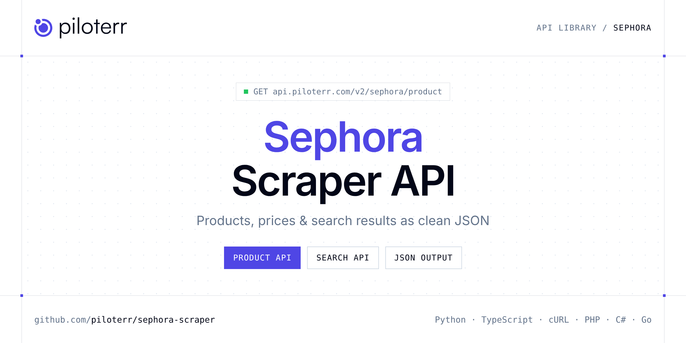

<p align="center">
  <a href="https://www.piloterr.com"></a>
</p>

# Sephora Scraper API

[](https://discord.gg/CFj3ph8aHU) [](https://app.piloterr.com) [](https://app.piloterr.com/openapi) [](LICENSE)

The **Piloterr Sephora Scraper API** lets you extract public data from Sephora as **clean, structured JSON** — no proxies, headless browsers or HTML parsing to maintain. Endpoints available in production:

- **Sephora Product API** — Read one European Sephora product by id or product URL.
- **Sephora Search API** — Search a European Sephora shop by keyword.

Use it for price monitoring, assortment tracking, competitor analysis, product research or catalog enrichment.

| Endpoint | Path | Credits | What you get |
|---|---|---|---|
| [Sephora Product API](#sephora-product-api) | `/v2/sephora/product` | 2 | Read one European Sephora product by id or product URL. Set region when you are not on the French shop. |
| [Sephora Search API](#sephora-search-api) | `/v2/sephora/search` | 2 | Search a European Sephora shop by keyword. Region defaults to France. Page through makeup and skincare cards. The US site is a different page and is not included. |

## Table of contents

- [How it works](#how-it-works)
- [Sephora Product API](#sephora-product-api)
- [Sephora Search API](#sephora-search-api)
- [Code examples in other languages](#code-examples-in-other-languages)
- [Practical use cases](#practical-use-cases)
- [Why Piloterr?](#why-piloterr)
- [FAQ](#faq)
- [Related scrapers](#related-scrapers)
- [Support](#support)

## How it works

1. **Create a free Piloterr account** and copy your API key from the [dashboard](https://app.piloterr.com).
2. **Send a `GET` (or `POST`) request** to `https://api.piloterr.com/v2/...` with the header `x-api-key: YOUR_API_KEY`.
3. **Receive structured JSON** — Piloterr handles rendering, proxies, retries and parsing.

```bash
export PILOTERR_API_KEY="your-api-key"
pip install requests        # Python
# TypeScript: Node.js 18+ (native fetch), run with `npx tsx file.ts`
```

> Every endpoint accepts both `GET` (query string) and `POST` (JSON body with the same fields).

## Sephora Product API

Read one European Sephora product by id or product URL. Set region when you are not on the French shop.

`GET | POST https://api.piloterr.com/v2/sephora/product` · **2 credits per request** · [Full reference](https://app.piloterr.com/openapi)

### Request parameters

| Parameter | Type | Required | Description |
|---|---|---|---|
| `query` | string | ✅ | A Sephora product URL. A product id such as 831955 also works. ``` https://www.sephora.fr/p/midnight-espresso---eau-de-parfum-au-cafe-831955.html ``` |
| `region` | string | — | Shop when query is only an id. Use fr for France or de for Germany. Leave empty for France. |
| `return_page_source` | boolean | — | Return the rendered HTML instead of JSON. |

### Python example

```python
import json
import os
import requests

response = requests.get(
    "https://api.piloterr.com/v2/sephora/product",
    headers={"x-api-key": os.environ["PILOTERR_API_KEY"]},
    params={
        "query": "https://www.sephora.fr/p/midnight-espresso---eau-de-parfum-au-cafe-831955.html",
    },
    timeout=60,
)
response.raise_for_status()
data = response.json()

print(json.dumps(data, indent=2, ensure_ascii=False)[:2000])
```

### TypeScript example

```typescript
type SephoraProduct = {
  id?: string;
  sku?: string;
  url?: string;
  name?: string;
  size?: string;
  badge?: string;
  brand?: string;
  price?: number;
  images?: string[];
  rating?: number;
  region?: string;
  currency?: string;
  in_stock?: boolean;
  variants?: {
    sku?: string;
    url?: string;
    name?: string;
    size?: string;
    price?: number;
    currency?: string;
    in_stock?: boolean;
    selected?: boolean;
    price_display?: string;
  }[];
  brand_url?: string;
  master_id?: string;
  unit_price?: number;
  review_count?: number;
  price_display?: string;
  unit_price_display?: string;
};

const params = new URLSearchParams({
  "query": "https://www.sephora.fr/p/midnight-espresso---eau-de-parfum-au-cafe-831955.html",
});

const response = await fetch(`https://api.piloterr.com/v2/sephora/product?${params}`, {
  headers: { "x-api-key": process.env.PILOTERR_API_KEY! },
});
if (!response.ok) throw new Error(`Piloterr error ${response.status}: ${await response.text()}`);

const data = (await response.json()) as SephoraProduct;

console.log(JSON.stringify(data, null, 2).slice(0, 2000));
```

<details>
<summary><b>POST variant</b></summary>

```http
POST https://api.piloterr.com/v2/sephora/product
x-api-key: YOUR_API_KEY
Content-Type: application/json

{"query": "https://www.sephora.fr/p/midnight-espresso---eau-de-parfum-au-cafe-831955.html"}
```
</details>

### Output example

Example response from the API reference, abridged — real values depend on the page you scrape.

```json
{
  "id": "831955",
  "sku": "831955",
  "url": "https://www.sephora.fr/p/midnight-espresso---eau-de-parfum-au-cafe-831955.html",
  "name": "Midnight Espresso - Eau de Parfum",
  "size": "75 ml",
  "badge": "Nouveauté",
  "brand": "KILIAN PARIS",
  "price": 145,
  "images": [
    "https://media.sephora.eu/content/dam/gdam/europe/digital/pim/published/K/KILIAN_PARIS/831955/410806-media_swatch-0.jpg?scaleWidth=750&sca…"
  ],
  "rating": 4.6,
  "region": "fr",
  "currency": "EUR",
  "in_stock": true,
  "variants": [
    {
      "sku": "831955",
      "url": "https://www.sephora.fr/p/midnight-espresso---eau-de-parfum-au-cafe-831955.html",
      "name": "Midnight Espresso - Eau de Parfum - 75 ml",
      "size": "75 ml",
      "price": 145,
      "currency": "EUR",
      "in_stock": true,
      "selected": true,
      "price_display": "145,00 €"
    }
  ],
  "brand_url": "https://www.sephora.fr/marques/de-a-a-z/kilian-paris-kilia/",
  "master_id": "P1000215059",
  "unit_price": 193.33,
  "review_count": 237,
  "price_display": "145,00 €",
  "unit_price_display": "193,33 € / 100ml"
}
```

### Response fields

| Field | Type | Description |
|---|---|---|
| `id` | string |  |
| `sku` | string |  |
| `url` | string |  |
| `name` | string |  |
| `size` | string |  |
| `badge` | string |  |
| `brand` | string |  |
| `price` | integer |  |
| `images` | string[] |  |
| `rating` | number |  |
| `region` | string |  |
| `currency` | string |  |
| `in_stock` | boolean |  |
| `variants[]` | object[] |  |
| `variants[].sku` | string |  |
| `variants[].url` | string |  |
| `variants[].name` | string |  |
| `variants[].size` | string |  |
| `variants[].price` | integer |  |
| `variants[].currency` | string |  |
| `variants[].in_stock` | boolean |  |
| `variants[].selected` | boolean |  |
| `variants[].price_display` | string |  |
| `brand_url` | string |  |
| `master_id` | string |  |

## Sephora Search API

Search a European Sephora shop by keyword. Region defaults to France. Page through makeup and skincare cards. The US site is a different page and is not included.

`GET | POST https://api.piloterr.com/v2/sephora/search` · **2 credits per request** · [Full reference](https://app.piloterr.com/openapi)

### Request parameters

| Parameter | Type | Required | Description |
|---|---|---|---|
| `query` | string | ✅ | A product word, for example mascara. Or paste a full Sephora search URL. |
| `region` | string | — | Shop code. Use fr for France or de for Germany. Leave empty for France. A full URL picks the shop. |
| `page` | number | — | Page number, starting at 1. Use 2 for the next page of products. |
| `return_page_source` | boolean | — | Return the rendered HTML instead of JSON. |

### Python example

```python
import json
import os
import requests

response = requests.get(
    "https://api.piloterr.com/v2/sephora/search",
    headers={"x-api-key": os.environ["PILOTERR_API_KEY"]},
    params={
        "query": "mascara",
    },
    timeout=60,
)
response.raise_for_status()
data = response.json()

print(json.dumps(data, indent=2, ensure_ascii=False)[:2000])
```

### TypeScript example

```typescript
type SephoraSearch = {
  results?: {
    id?: string;
    url?: string;
    name?: string;
    size?: string;
    badge?: string;
    brand?: string;
    image?: string;
    price?: number;
    rating?: number;
    region?: string;
    currency?: string;
    subtitle?: string;
    review_count?: number;
    price_display?: string;
    call_to_action?: string;
  }[];
  pagination?: {
    next?: string;
    page?: number;
    per_page?: number;
    total_pages?: number;
    total_results?: number;
  };
};

const params = new URLSearchParams({
  "query": "mascara",
});

const response = await fetch(`https://api.piloterr.com/v2/sephora/search?${params}`, {
  headers: { "x-api-key": process.env.PILOTERR_API_KEY! },
});
if (!response.ok) throw new Error(`Piloterr error ${response.status}: ${await response.text()}`);

const data = (await response.json()) as SephoraSearch;

console.log(JSON.stringify(data, null, 2).slice(0, 2000));
```

<details>
<summary><b>POST variant</b></summary>

```http
POST https://api.piloterr.com/v2/sephora/search
x-api-key: YOUR_API_KEY
Content-Type: application/json

{"query": "mascara"}
```
</details>

### Output example

Example response from the API reference, abridged — real values depend on the page you scrape.

```json
{
  "results": [
    {
      "id": "836334",
      "url": "https://www.sephora.fr/p/vertigo---coffret-vertigo-mascara-836334.html",
      "name": "Vertigo",
      "size": "10 ml + 3.9 ml + 3.9 ml",
      "badge": "Nouveauté",
      "brand": "ARMANI",
      "image": "https://media.sephora.eu/content/dam/gdam/europe/digital/pim/published/A/ARMANI/836334/414410-media_swatch-0.jpg?scaleWidth=3840&scaleMod…",
      "price": 95,
      "rating": 4.7,
      "region": "fr",
      "currency": "EUR",
      "subtitle": "Coffret Vertigo mascara",
      "review_count": 454,
      "price_display": "95,00 €",
      "call_to_action": "Ajouter au panier"
    }
  ],
  "pagination": {
    "next": "https://www.sephora.fr/recherche/?q=mascara&page=2",
    "page": 1,
    "per_page": 24,
    "total_pages": 9,
    "total_results": 215
  }
}
```

### Response fields

| Field | Type | Description |
|---|---|---|
| `results[]` | object[] |  |
| `results[].id` | string |  |
| `results[].url` | string |  |
| `results[].name` | string |  |
| `results[].size` | string |  |
| `results[].badge` | string |  |
| `results[].brand` | string |  |
| `results[].image` | string |  |
| `results[].price` | integer |  |
| `results[].rating` | number |  |
| `results[].region` | string |  |
| `results[].currency` | string |  |
| `results[].subtitle` | string |  |
| `results[].review_count` | integer |  |
| `results[].price_display` | string |  |
| `results[].call_to_action` | string |  |
| `pagination` | object |  |
| `pagination.next` | string |  |
| `pagination.page` | integer |  |
| `pagination.per_page` | integer |  |
| `pagination.total_pages` | integer |  |
| `pagination.total_results` | integer |  |

## Code examples in other languages

Ready-to-run examples live in the [`examples/`](examples) folder. Each one reads your key from the `PILOTERR_API_KEY` environment variable.

| Language | Product | Search |
|---|---|---|
| cURL (Bash) | [`product`](examples/curl/product.sh) | [`search`](examples/curl/search.sh) |
| PHP | [`product`](examples/php/product.php) | [`search`](examples/php/search.php) |
| C# | [`product`](examples/csharp/Product.cs) | [`search`](examples/csharp/Search.cs) |
| Go | [`product`](examples/go/product.go) | [`search`](examples/go/search.go) |
| Java | [`product`](examples/java/ProductExample.java) | [`search`](examples/java/SearchExample.java) |
| Ruby | [`product`](examples/ruby/product.rb) | [`search`](examples/ruby/search.rb) |
| Node.js | [`product`](examples/nodejs/product.mjs) | [`search`](examples/nodejs/search.mjs) |

## Practical use cases

- **Price monitoring** — Track prices, promotions and availability over time to react to competitors.
- **Assortment & catalog tracking** — Follow new products, delisted items and category changes.
- **Competitor analysis** — Benchmark ranges, brands and positioning across retailers.
- **Product research** — Spot best-sellers and trends from search results.
- **Catalog enrichment** — Pull titles, images and attributes into your PIM or marketplace listings.

## Why Piloterr?

- **No infrastructure** — no proxies, headless browsers or CAPTCHA solving to run yourself.
- **Structured JSON** — stable, documented fields instead of brittle HTML selectors.
- **Pay per request** — transparent credit cost per endpoint, failed requests are retried for you.
- **One API key, hundreds of sources** — Sephora plus many other e-commerce, search and company data endpoints in the [Piloterr library](https://www.piloterr.com/library).
- **Any language** — plain HTTPS + JSON, with examples for Python, TypeScript, cURL, PHP, C#, Go, Java, Ruby and Node.js.

## FAQ

### Is it legal to scrape Sephora?

Collecting publicly available data is generally allowed in many jurisdictions, but rules depend on your country, the data you collect and how you use it. Avoid personal data unless you have a lawful basis, respect the website's terms where they apply, and get legal advice for your specific use case. This is not legal advice.

### Do I need proxies or a headless browser?

No. Piloterr handles rendering, proxy rotation and retries on its side. You only send an HTTPS request with your `x-api-key` header and receive JSON.

### How much does a request cost?

Credits per call: `/v2/sephora/product` **2**, `/v2/sephora/search` **2**. See the [Piloterr website](https://www.piloterr.com) for plans.

### What data does the Sephora API return?

Each endpoint returns structured JSON: **Sephora Product** — `id`, `sku`, `url`, `name`, `size`, `badge`; **Sephora Search** — `results[]`, `results[].id`, `results[].url`, `results[].name`, `results[].size`, `results[].badge`.

### How do I paginate Sephora results?

Use the `page` parameter and keep requesting while the response indicates more results.

### Can I target a specific country or language?

Yes, use `region` — see the parameter tables above for accepted values.

### Can I get the raw HTML instead of JSON?

Yes. Set `return_page_source=true` and the response becomes `{"result": "..."}` with the page source.

### Which languages are supported?

Any language that can make an HTTP request. This README shows Python and TypeScript; the [`examples/`](examples) folder contains cURL, PHP, C#, Go, Java, Ruby and Node.js.

## Related scrapers

- [About You Scraper API](https://github.com/piloterr/aboutyou-scraper)
- [Action Scraper API](https://github.com/piloterr/action-scraper)
- [Aldi Scraper API](https://github.com/piloterr/aldi-scraper)
- [Alibaba Scraper API](https://github.com/piloterr/alibaba-scraper)
- [AliExpress Scraper API](https://github.com/piloterr/aliexpress-scraper)
- [Allegro Scraper API](https://github.com/piloterr/allegro-scraper)
- [All Piloterr scrapers on GitHub](https://github.com/piloterr)

## Support

- 💬 Join the [Piloterr Discord](https://discord.gg/CFj3ph8aHU) to ask questions and share what you build.
- 📚 Browse the [API reference (OpenAPI)](https://app.piloterr.com/openapi) and the [Piloterr library](https://www.piloterr.com/library).
- 🔑 [Get your API key](https://app.piloterr.com).

---

<p align="center">
  <a href="https://www.piloterr.com">
    <picture>
      <source media="(prefers-color-scheme: dark)" srcset="images/logo-dark.svg">
      
    </picture>
  </a>
  <br>
  <sub>Built by <a href="https://www.piloterr.com">Piloterr</a> — web scraping APIs for e-commerce, search, real estate and more, one API key.</sub>
</p>

<sub>Sephora is a trademark of its respective owner. This repository is not affiliated with or endorsed by Sephora. Examples are released under the MIT license.</sub>
